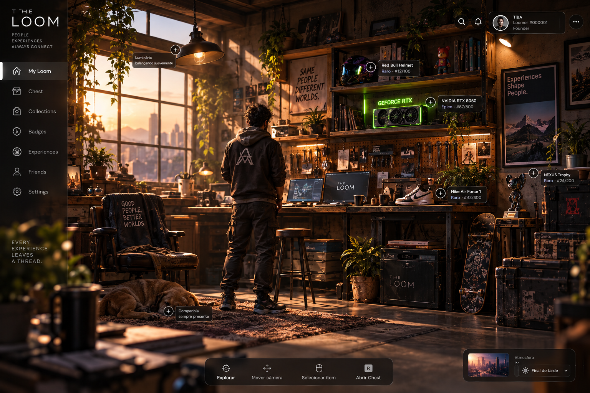

# Direção visual: "My Loom" como fundo de tela

Referência oficial: [`referencias/my-loom-v1.png`](referencias/my-loom-v1.png) (tela "My Loom" do app The Loom).

## O que a referência define
- **Marca:** THE LOOM, *"People · Experiences · Always connect"*, *"Every experience leaves a thread"*.
- **Identidade:** perfil `TIBA · Loomer #000001 · Founder`. O ID tem formato `#000001` e o @handle é o apelido dele.
- **Cenário:** loft/oficina geek em **"final de tarde"**: luz dourada entrando pela janela com a cidade ao fundo,
  plantas penduradas, prateleiras, pegboard de ferramentas, setup com 2 monitores (um com o logo The Loom),
  poltrona, tapete, baús "The Loom", skate, cachorro dormindo.
- **Itens colecionáveis expostos no quarto**, cada um com raridade e tiragem numerada:
  `Red Bull Helmet · Raro · #12/100`, `NVIDIA RTX 5050 · Épico · #87/500`,
  `Nike Air Force 1 · Raro · #43/300`, `NEXUS Trophy · Raro · #24/200`.
- **Detalhes vivos:** "Luminária balançando suavemente", "Companhia sempre presente" (o cachorro).
- **App completo (não vai para o wallpaper):** menu lateral (My Loom, Chest, Collections, Badges, Experiences,
  Friends, Settings), barra inferior (Explorar, Mover câmera, Selecionar item, Abrir Chest) e seletor de **Atmosfera**.

## Diferenças para a versão wallpaper
| Ponto | Na referência | No wallpaper |
|---|---|---|
| Personagem | de costas, olhando o setup | **de frente para a câmera**, em pose idle (respirando, olhando ao redor, de vez em quando mexendo no celular ou na caneca) |
| Interface | menu, barras, rótulos | **sem UI**: só o quarto (os ícones do desktop ficam por cima) |
| Rótulos dos itens | sempre visíveis | **não aparecem** (wallpaper só visual, sem interação) |
| Atmosfera | escolhida manualmente | **segue o horário real** (manhã, tarde, final de tarde, noite), com opção de travar uma |
| Composição | personagem no centro | personagem **deslocado para um lado** e área livre à esquerda, onde ficam os ícones do Windows/Mac |

## Animações ambientes (baratas, sempre ligadas)
Luminária balançando · cachorro respirando e mexendo a orelha · poeira nos raios de luz · folhas das plantas ·
brilho pulsante do neon da RTX · telas dos monitores com conteúdo leve · luzes da cidade acendendo à noite ·
câmera com micro-movimento automático (sem seguir o mouse).

## Como chegar nesse nível de qualidade sem pesar no PC
A referência tem qualidade de render offline (iluminação global, sombras suaves, profundidade de campo).
Calcular tudo isso em tempo real custaria GPU de jogo. Recomendação: **3D em tempo real com iluminação "assada" (baked)**.
1. O quarto é modelado e iluminado no **Blender**. Luz, sombras e reflexos difusos são **pré-calculados em texturas (lightmaps)**.
2. Em tempo real (Three.js) só entram: luz da luminária (que balança), o personagem animado, partículas,
   neon e efeitos leves (bloom, profundidade de campo barata). É o mesmo princípio do WE: pré-compilar tudo o que dá.
3. **Uma variante de lightmap por atmosfera** (tarde, final de tarde, noite), com transição suave entre elas.
4. Itens colecionáveis são modelos `.glb` plugáveis em **"slots" do cenário** (prateleira, mesa, parede, chão), vindos do manifesto da conta.
5. O personagem é um avatar `.glb` com esqueleto e animações idle. **Ainda não existe** (ver Status).

**Plano B, mais leve:** renderizar o quarto em camadas no Blender e animar por parallax e loops de vídeo, no estilo do lwp.
Fica com cara de render, mas perde a liberdade de trocar itens e mover a câmera.

## Status
O quarto **ainda não existe em 3D**: só esta imagem de referência. Primeiro passo de arte: modelar o quarto base
no Blender seguindo a referência, já pensado em slots para itens e em lightmaps por atmosfera.

O **personagem também não existe**. Proposta em duas etapas:
1. **MVP:** um personagem base (no estilo da referência: moletom The Loom, calça cargo, tênis), modelado,
   com esqueleto padrão de humanoide e 3–5 animações idle em loop (respirar, olhar ao redor, celular, caneca, alongar).
2. **Visitas:** o quarto tem uma **segunda posição de personagem** (poltrona, banqueta, encostado na mesa) e animações em dupla, para quando um amigo ou namorado(a) visita.
3. **Depois:** personalização por Loomer sobre o mesmo esqueleto (rosto, cabelo, pele, roupas, e os itens
   vestíveis da coleção, como o capacete e o tênis). Assim todas as animações servem para todos.

Os **itens colecionáveis também não existem**. Padrão proposto para todo item, para que qualquer artista produza e o app encaixe sozinho:
| Campo | Padrão |
|---|---|
| Arquivo | `.glb` com texturas KTX2/Basis (compressão de GPU, a mesma ideia do DXT do WE) |
| Orçamento | até ~15 mil triângulos e texturas de 1024 px por item (LOD menor para o modo leve) |
| Slot | `prateleira`, `mesa`, `parede`, `chão`, `vestível` (no personagem) |
| Origem | pivô na base do objeto, escala real em metros, frente apontando para +Z |
| Dados | `nome`, `raridade` (Comum, Raro, Épico, Lendário…), `tiragem` (#12/100), `animação` opcional (ex.: neon pulsando) |

**Atenção a marcas reais:** Red Bull, NVIDIA/GeForce e Nike são marcas registradas. Usar o nome ou o
visual delas em itens colecionáveis exige **parceria ou licença**. Até lá, usar itens genéricos ou da própria The Loom.

## Decidido
- Personagem: base única primeiro, personalização depois.
- Itens: próprios/genéricos no lançamento (sem marcas reais).
- Responsável pela arte 3D: a definir.
